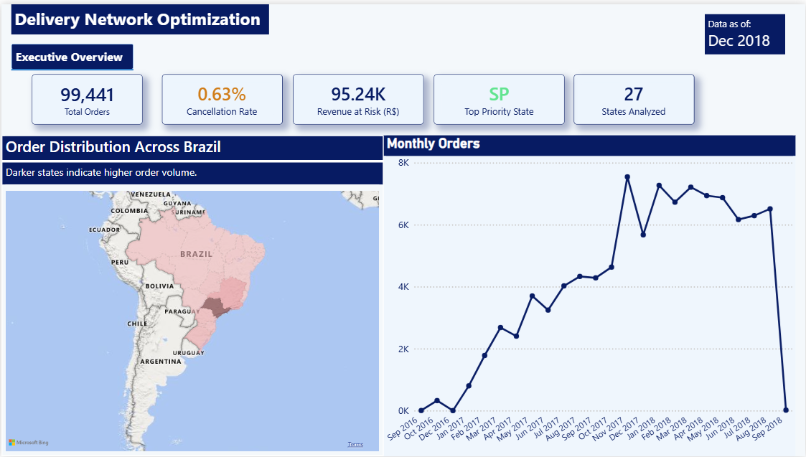
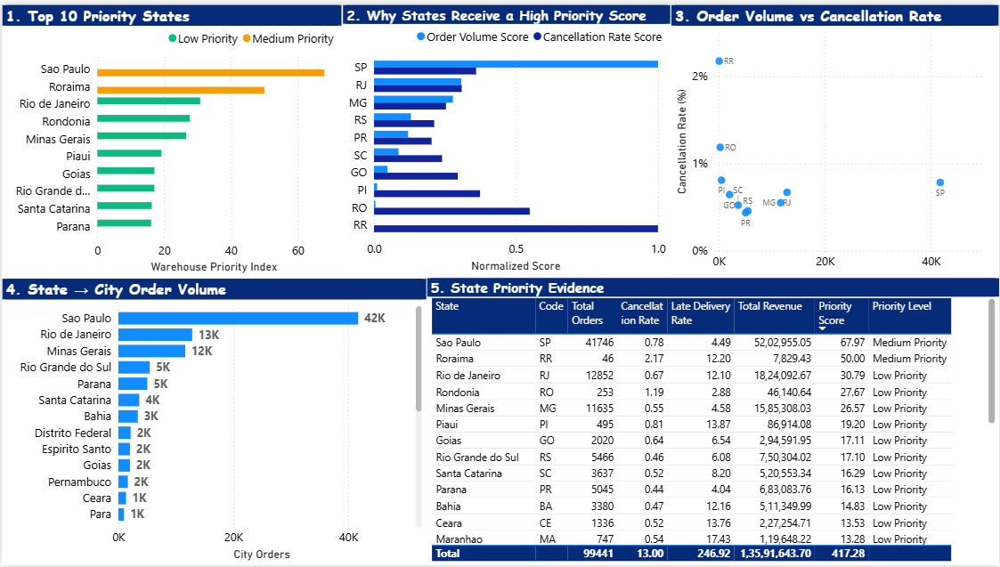
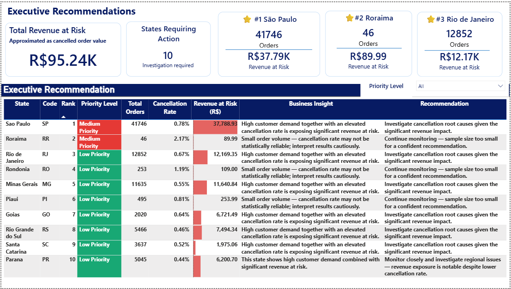

# Delivery_Optimization_analysis

## 📌 Executive Summary

|                                   |                                                                                                                                                                                                                                                                                                                                                    |
| --------------------------------- | -------------------------------------------------------------------------------------------------------------------------------------------------------------------------------------------------------------------------------------------------------------------------------------------------------------------------------------------------- |
| **Business Problem**              | Which regions in Brazil require fulfillment/operational investigation or investment, and how much revenue is currently exposed to cancellations?                                                                                                                                                                                                   |
| **Approach**                      | Built a PostgreSQL data warehouse from 99,441 real e-commerce orders, ran a 6-dimension data quality audit, engineered a normalized Warehouse Priority Index, and statistically validated the major relationships and assumptions underlying the recommendations.                                                                                  |
| **Key Finding**                   | São Paulo drives 39.7% of total revenue at risk on its own; just 3 states account for 64.7% of all cancelled-order value. Order volume and cancellation rate are not significantly linearly associated (r = 0.156, p = 0.437), suggesting that cancellation risk should not be assumed to increase simply because a state has higher order volume. |
| **Recommendation**                | Prioritize fulfillment investigation in São Paulo, Rio de Janeiro, and Minas Gerais; investigate courier/operational root causes in the 6 states flagged as "Critical Zone" (high cancellation + high late-delivery rate).                                                                                                                         |
| **Financial Exposure Identified** | R$95,235.27 in cancelled-order value identified and localized to specific, actionable regions — turning a vague "improve delivery" goal into a ranked, evidence-backed action list.                                                                                                                                                                |

---

## 🧩 What I Built

This project combines four layers of analytics:

- **Data Engineering:** PostgreSQL data warehouse built from 9 relational Olist datasets, using a snowflake schema
- **Data Quality:** 6-dimension audit covering completeness, uniqueness, validity, accuracy, consistency, and timeliness
- **Data Analytics:** State/city KPIs, cancellation analysis, revenue-at-risk analysis, statistical validation (correlation, chi-square, Cramér's V), and Pareto analysis
- **Business Intelligence:** 3-page Power BI dashboard converting analysis into prioritized operational recommendations

### Core Skills Demonstrated

`SQL` · `PostgreSQL` · `Python` · `Pandas` · `SciPy` · `Power BI` · `DAX` · `Data Modeling` · `Statistics` · `Business Analysis` · `Data Visualization`

## ⭐ Project Highlights

- **99,441** real e-commerce orders analyzed
- **PostgreSQL data warehouse** designed using a snowflake schema
- **6-dimension data quality audit** performed before analytical modeling
- **Warehouse Priority Index** developed to rank operational risk
- **27 Brazilian states** present in the warehouse; **23 had cancelled orders** and were included in the revenue-at-risk analysis
- **R$95.24K** revenue at risk identified
- **64.7%** of revenue at risk concentrated in the top 3 states
- **6 states classified as Critical Zone** using cancellation + late-delivery performance
- **3-page Power BI executive dashboard** built for decision support
- **Python statistical analysis layer** developed beyond the dashboard

---

## 🎯 Business Problem

E-commerce platforms lose revenue and customer trust when orders are delayed or cancelled — but not every region needs the same intervention. Without a structured, data-driven view, operations teams are left guessing which states/cities deserve fulfillment investigation or investment first.

**This project answers three questions:**

1. Which states/cities have the highest combination of demand and service failure?
2. How much revenue is currently exposed to cancellations, and where is it concentrated?
3. Are these problems statistically real, or just noise in the data?

---

## 🔑 Key Findings

| #   | Finding                                                                                                                                                                                  |
| --- | ---------------------------------------------------------------------------------------------------------------------------------------------------------------------------------------- |
| 1   | **São Paulo** is the top priority state — highest order volume (41,746), highest revenue at risk (R$37.79K), and above-median cancellation rate                                          |
| 2   | Order volume and cancellation rate are not significantly linearly associated (r = 0.156, p = 0.437) — high order volume alone does not imply higher cancellation risk                    |
| 3   | **Top 3 states account for 64.7%** of total revenue at risk; the top 5 account for 79.6%, and the top 6 reach 86.1% (Pareto concentration pattern)                                       |
| 4   | **6 states fall into the "Critical Zone"** (above-median cancellation _and_ late-delivery rate): Roraima, Piauí, Rio de Janeiro, Maranhão, Ceará, Bahia                                  |
| 5   | Late-delivered orders take **33.9 days on average** vs **10.9 days** for on-time orders — a ~3x difference in fulfillment duration                                                       |
| 6   | State-level cancellation rates differ significantly (Chi-square p = 0.006), although the effect size is small (Cramér's V = 0.02) — the relationship is real but not the dominant driver |

---

## 📈 Key Metrics

| Metric                         |                                     Result |
| ------------------------------ | -----------------------------------------: |
| Total Orders                   |                                     99,441 |
| States in Database             |     27 (all Brazilian states in dim_state) |
| States with Cancelled Orders   |  23 (included in Revenue-at-Risk analysis) |
| Revenue at Risk                |                                   R$95.24K |
| Top State by Orders            |                         São Paulo — 41,746 |
| Top State Revenue at Risk      |                       São Paulo — R$37.79K |
| Top 3 Share of Revenue at Risk |                                      64.7% |
| Pareto Concentration           | Top 5 states = 79.6%; Top 6 states = 86.1% |
| States in Critical Zone        |                                          6 |
| Late Delivered Orders          |                                      6,535 |
| Avg. On-Time Fulfillment       |                                  10.9 days |
| Avg. Late Fulfillment          |                                  33.9 days |

---

## 💼 Business Recommendations

The analysis translates statistical findings into operational decisions — the recruiter shouldn't have to convert findings into actions themselves:

| Priority           | State / Area   | Evidence                                                                     | Recommended Action                                                                                 |
| ------------------ | -------------- | ---------------------------------------------------------------------------- | -------------------------------------------------------------------------------------------------- |
| 🔴 1               | São Paulo      | Highest order volume and R$37.79K revenue at risk                            | Investigate cancellation root causes and assess courier/fulfillment capacity on high-volume routes |
| 🟠 2               | Rio de Janeiro | R$12.17K revenue at risk + above-median cancellation and late-delivery rates | Investigate fulfillment and courier performance                                                    |
| 🟠 3               | Minas Gerais   | R$11.64K revenue at risk + elevated cancellation rate                        | Review operational bottlenecks and factors associated with cancellation                            |
| 🔴 Critical Zone   | 6 states       | Above-median cancellation + above-median late-delivery rates                 | Prioritize operational investigation                                                               |
| 📊 Portfolio-level | Top 5 states   | 79.6% of revenue at risk                                                     | Concentrate improvement resources rather than spreading them across all states                     |

### Business Decision

The analysis suggests operational resources should not be distributed equally across Brazil. Instead, management should:

1. Focus investigation on high-revenue-risk states
2. Prioritize states where cancellation and late delivery occur together
3. Treat low-volume states cautiously — their rates are statistically less reliable
4. Use revenue at risk to prioritize financial impact
5. Monitor cancellation and fulfillment performance after operational interventions

---

## 📊 Power BI Dashboard

### Page 1 — Executive Overview

Provides a high-level view of order volume, cancellation rate, revenue at risk, geographic distribution, and monthly order trends.

---

### Page 2 — Priority Analysis

Explains which states require attention and why, combining the Warehouse Priority Index, the volume-vs-cancellation breakdown behind each score, a statistical correlation check, and a state→city drill-down — structured as a narrative, each chart answering the question the previous one raises.

---

### Page 3 — Executive Recommendations

Converts the analytical findings into prioritized business actions, highlighting the top states, revenue at risk, business insights, and recommended actions.

---
